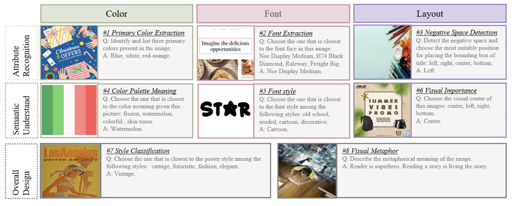
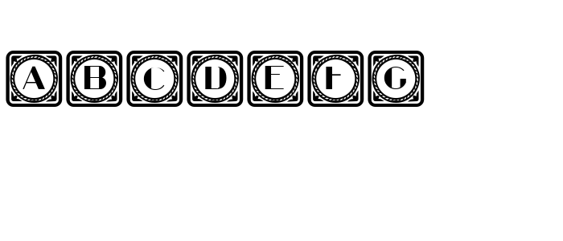
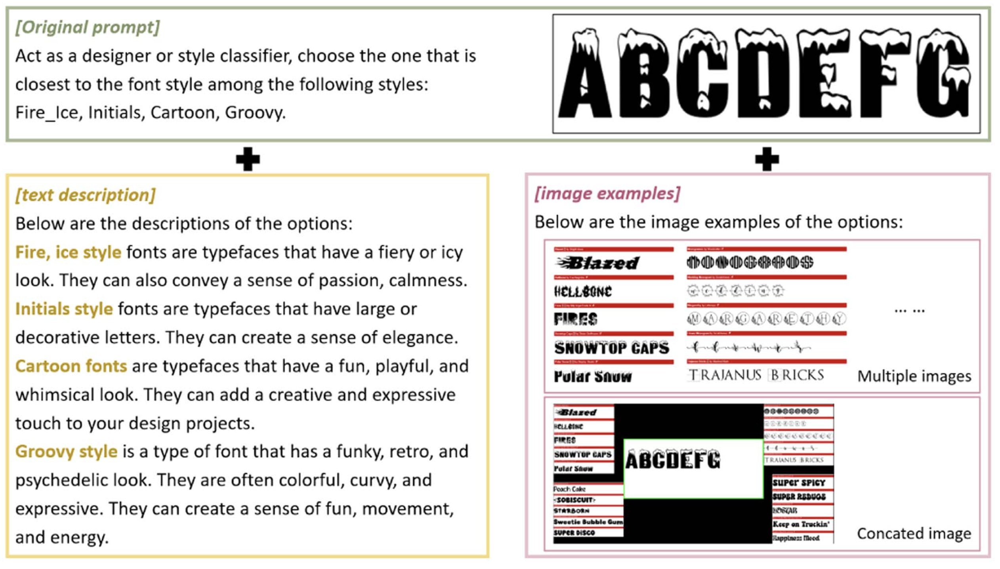

Official repository for **Can Multimodal Large Language Models Understand Graphic Design? A Comparative Study**, *IEEE Transactions on Multimedia*, 2026. ([Paper](https://doi.org/10.1109/TMM.2026.3684992)), which evaluates graphic design understanding in multimodal large language models through eight tasks spanning recognition, semantic understanding, and overall design. This release provides **1.6K image samples and 5.2K questions**.



## Repository contents

```text
├── data/                                            # Main benchmark images, questions, and answers
├── GPT4_evaluator_prompts/                           # Exact evaluator prompt for 8 tasks
├── eval_gpt4.py                                      # Lightweight script to reproduce GPT-4 scores
├── requirements.txt                               
├── baseline_version.txt                             # Commit hashes and API versions for all models
├── human_validation/
│   ├── evaluator640_test_annotations.csv             # 640 human-validated samples & GPT-4 scores
│   └── negative_space_detection_annotations.csv      # Additional raw annotations for Task #3
├── supplementary_material/
│   └── supplementary.pdf                            # Supplementary document for model stability
├── pic/                                             # Figures shown in this README
└── README.md
```

## Evaluation

1. **Generate model answers.** Load `data/<task>/annotations.json` and send each `image` and `question` to the model being tested.
2. **Grade the answers.** We use GPT-4 to compare model answers with the reference `answer`. The evaluator prompts are in [GPT4_evaluator_prompts/](GPT4_evaluator_prompts/), and the calling procedure is provided in [eval_gpt4.py](eval_gpt4.py).
3. **Aggregate scores.** For each multiple-choice task, compute the score at each answer `position` and report the mean across the four positions. Open-answer tasks are evaluated once.

## Exploration and analysis

### 1. Prompt rewriting

The following prompts use the same Font Style example. The correct answer is **Initials**.



**Original**

> Act as a designer or style classifier, choose the one that is closest to the font style among the following styles: Initials, Stencil_Army, Typewriter, Grid. 

**GPT-4 — short**

> Act as a style classifier and identify the closest match to the font style among:Initials, Stencil_Army, Typewriter, Grid.

**GPT-4 — medium**

> Act as a designer and font style classifier. Analyze the provided font and determine which category it most closely aligns with: Initials, Stencil_Army, Typewriter, Grid.  Explain your choice by identifying the key visual characteristics of the font and how they correspond to the defining features of the selected category.

**GPT-4 — long**

>  Act as a professional designer and style classifier. Carefully analyze the provided image and evaluate its visual characteristics, including composition, typography, color palette, imagery, and overall aesthetic. Based on your analysis, determine which style the font most closely resembles from the following options:Initials, Stencil_Army, Typewriter, Grid. Consider the unique design principles and features of each option when making your decision. Provide a clear and concise explanation for your choice, highlighting the key elements in the image that align with the selected style. Your response should demonstrate expertise in design and visual classification.

**Llama-3.1 — short**

> Classify the font style. Which style is closest: Initials, Stencil_Army, Typewriter, Grid.

### 2. Incorporating supplementary information

Text descriptions and visual examples provide additional information about each option:



## Citation

If you use DesignProbe, please cite our paper:

```bibtex
@article{lin2026designprobe,
  author  = {Lin, Jieru and Huang, Danqing and Zhao, Tiejun and Zhan, Dechen and Lin, Chin-Yew},
  title   = {Can Multimodal Large Language Models Understand Graphic Design? A Comparative Study},
  journal = {IEEE Transactions on Multimedia},
  volume  = {28},
  pages   = {9178--9188},
  year    = {2026},
  doi     = {10.1109/TMM.2026.3684992}
}
```
